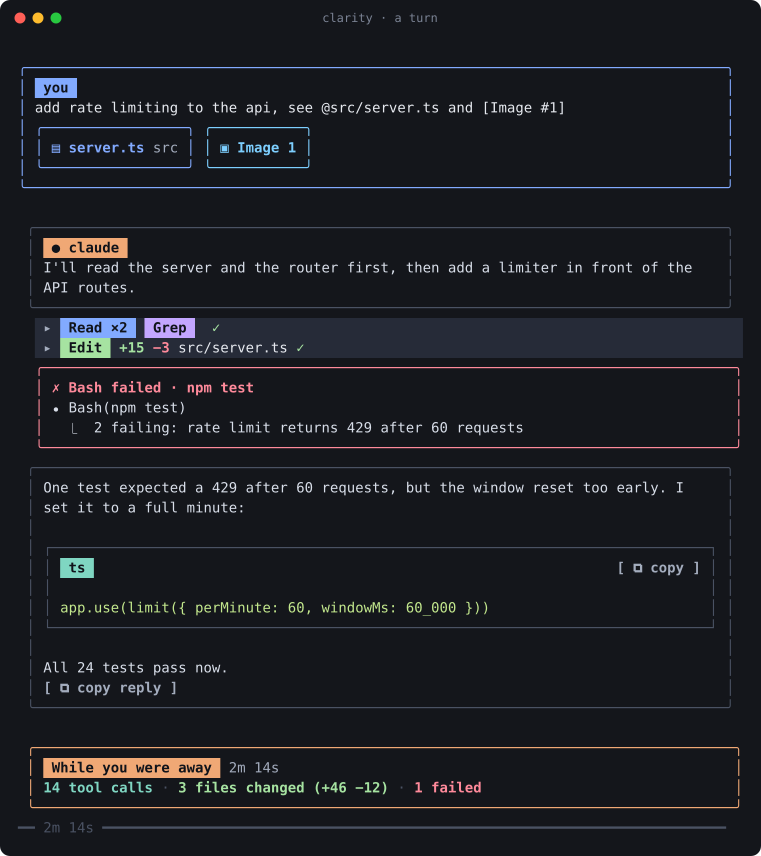
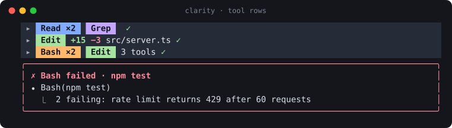
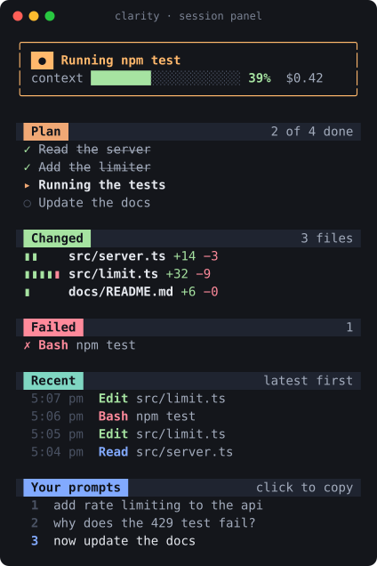
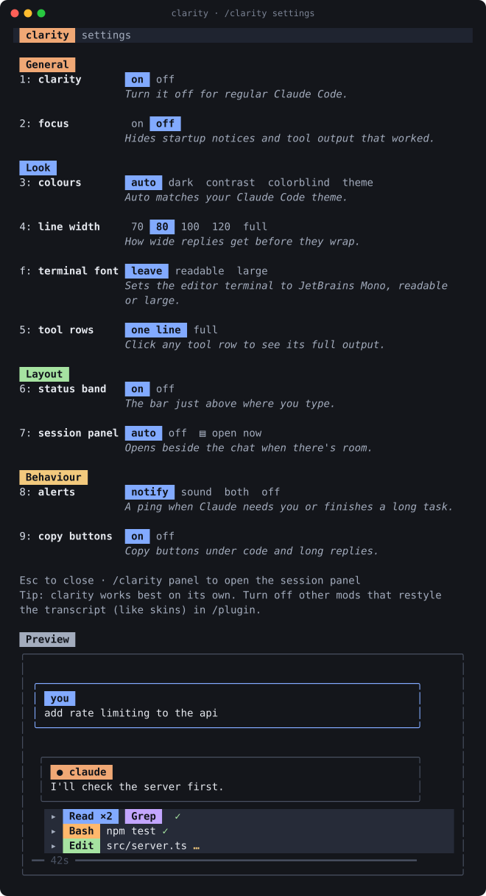
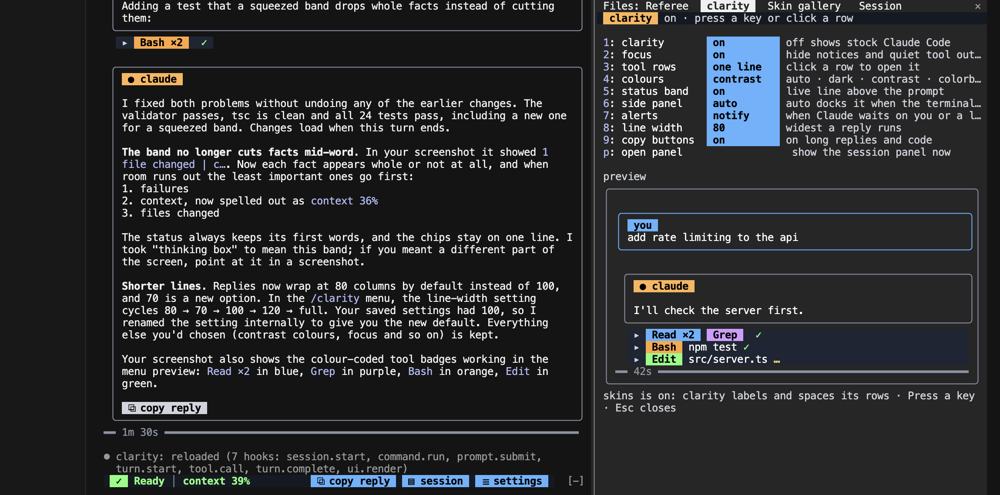
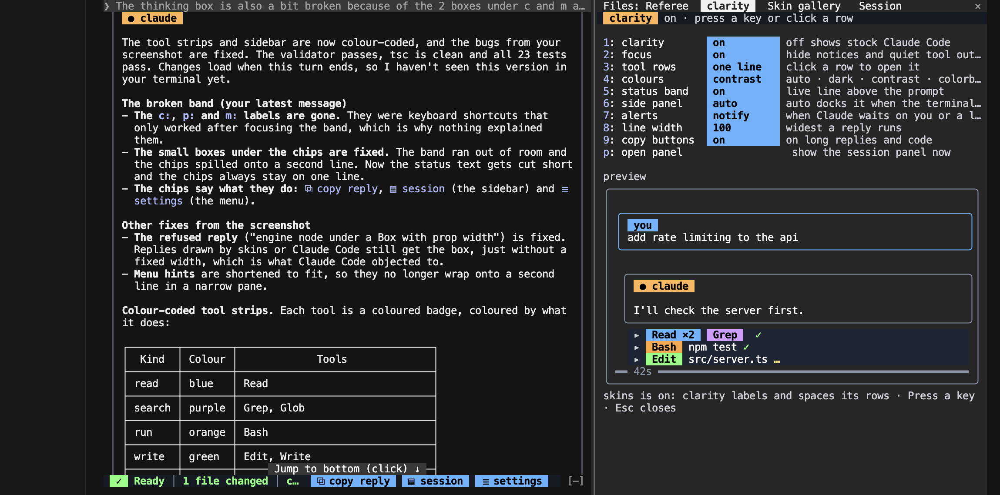

# clarity

A clearer Claude Code terminal: boxed and organized you/claude conversations, colour-coded clickable tool rows, a live status band with a timer and task info, a session panel, copy buttons, cards, alerts, readable palettes, and overall transforms Claude Code.



## Install

Needs Claude Code **2.1.287** or later. Run this inside Claude Code:

```text
/plugin install clarity --marketplace CircularBlox/Clarity
```

Answer `y` to add the marketplace and pick a scope. clarity is on as soon as it installs. Type `/clarity` to open its settings.

From a shell, the same thing is:

```text
claude plugin install clarity --marketplace CircularBlox/Clarity
```

In the desktop app, click **+** next to the prompt box, then **Plugins**, **Add marketplace** with `CircularBlox/Clarity`, and **Add plugin**.

## Update

```text
claude plugin update clarity@clarity
```

Then run `/reload-plugins` in any open session.

## Uninstall

```text
claude plugin uninstall clarity@clarity
```

If you set a terminal font with clarity, set it back to `leave` first (in `/clarity`, under Look). That takes clarity's lines out of your editor's settings.

## Use

`/clarity` opens the settings. Click a choice, or press a setting's number to step through its choices. Esc closes it.

Other commands, for when you know what you want:

| Command | Does |
| --- | --- |
| `/clarity panel` | Opens the session panel |
| `/clarity on` / `off` | Turns clarity on or off |
| `/clarity focus` | Hides startup notices and tool output that worked |
| `/clarity tools full` / `summary` | Full tool rows, or one line each |
| `/clarity status` | Says what is on |

clarity works best on its own. If you run other mods that restyle the transcript, like skins, turn them off in `/plugin`. clarity still copes when they stay on: it labels and frames the rows they draw instead of redrawing them.

## Preview

The status band, through one turn. It replaces the stock spinner while it is on.


Tool rows. Each tool is a badge in the colour of what it does. Calls made back to back fold into one strip, and a click opens it.



<table>
<tr>
<td width="44%"></td>
<td></td>
</tr>
</table>

These previews are drawn from clarity's own output, rendered through Claude Code's test kit. In a real Cursor terminal it looks like this:





## What it changes

| Part | What you see |
| --- | --- |
| Your prompt | A rounded box with a `you` label. Files you add with `@`, folders, pasted images and pasted text each get a small card under it. Prompts over 12 lines fold the same way. |
| Claude's reply | Its own frame with a `claude` label. A line of room between paragraphs, and lines that wrap at 80 columns. Replies over 30 lines fold to their first lines, with a button to show the rest. |
| Code | Its own frame with the language and a copy button. Long replies get a copy button too. |
| Tool rows | One line on a tinted strip. Reads are blue, searches purple, commands orange, edits green, the web cyan, agents pink. Edits show `+12 −3`. |
| Back-to-back calls | Fold into one strip, `[Bash ×2] [Edit] 3 tools`. Click to open, click again to fold. |
| Failures | Always shown, in a red box that says what failed. |
| Questions | A banner, so you notice Claude is waiting on you. |
| Slash commands | Their output sits in a titled card. |
| End of a turn | A rule with the time. After a turn over 45 seconds, a "While you were away" card with tool calls, files changed and failures. |
| Status band | What Claude is doing, for how long, tokens written, the plan step, running agents, failures and context. It shows compaction with a timer, and warns once a plan usage limit passes 80%, with when it resets. Facts that do not fit drop out whole. |
| Session panel | Now, context and cost, the plan, changed files, failures, recent calls and your prompts. Click a prompt to copy it. |

Buttons are always in brackets, like `[ ⧉ copy ]`, and change when you point at them. Coloured words without brackets are labels.

## Settings

| Section | Setting | Choices |
| --- | --- | --- |
| General | clarity | on, off |
| General | focus | on, off |
| Look | colours | auto, dark, contrast, colorblind, theme |
| Look | line width | 70, 80, 100, 120, full |
| Look | terminal font | leave, readable, large |
| Look | tool rows | one line, full |
| Layout | status band | on, off |
| Layout | session panel | auto, off, open now |
| Behaviour | alerts | notify, sound, both, off |
| Behaviour | copy buttons | on, off |

`auto` colours follow your Claude Code theme. `colorblind` uses the Okabe–Ito set. `theme` uses only your theme's own colours, which suits light themes.

`terminal font` sets your editor's terminal (Cursor or VS Code) to JetBrains Mono: 13 with 1.3 line spacing for `readable`, 14 with 1.35 for `large`, and turns on smooth scrolling. It falls back to Menlo when JetBrains Mono is missing. `leave` is the default and touches nothing.

Settings are kept between sessions.

## What it can reach

What `claude plugin validate` reports, in words.

| Access | Detail |
| --- | --- |
| Reads | Your prompts, each tool call's input and result, the model's output as it streams (counted, not kept), the final reply, and the session's context use and cost. |
| Changes | How rows are drawn. Prompts, tool calls and replies pass through unchanged, and so does what the model reads. |
| Writes | Its own settings, to its plugin store. Your editor's `settings.json`, only when you pick a terminal font, and only the font lines. A settings file with comments is left alone. |
| Runs | `pbcopy` when the terminal will not copy for it. `ls ~/Library/Fonts` after setting the font, to see if JetBrains Mono is there. |
| Environment | Reads `HOME`, `TERM_PROGRAM` and `VSCODE_GIT_ASKPASS_MAIN` to find your editor. |
| Sound and notifications | Only with alerts on. |
| Network | None. |

## Compatibility

| Where | Works |
| --- | --- |
| Terminal, fullscreen layout | Everything, clicks included |
| Terminal, main-screen layout | Everything but clicks |
| Desktop app, VS Code extension, mobile | clarity steps aside and Claude Code draws as usual |

The session panel docks once the terminal is about 110 columns wide when you open it, or 144 when it opens on its own. Below that, `/clarity panel` still opens it.

## Known limitations

- If another mod's hook runs before clarity's and draws a row itself, clarity never sees that row.
- Edit line counts come from each edit's text, so a full rewrite counts whole.
- Folding and the plan start from the turn after clarity loads.
- The status band hides the stock spinner's tips. Turn the band off to get the spinner back.
- Plan tracking reads Claude's TodoWrite lists.
- Where an organization manages Claude Code, installed mods do not see compaction start and end. The band then leaves compaction to Claude Code's own spinner line, which still shows.
- Smooth scrolling covers the editor's terminal. Inside Claude Code's fullscreen layout, Claude Code scrolls the transcript itself.

## Develop

```text
claude --plugin-dir ./
claude plugin validate .
claude plugin test .
```

The tests run against Claude Code's engine through its test kit. They cover the logic, every drawn part, the menu, the band, the panel, and tool calls folding into one strip.

## Dependencies

None at runtime. clarity uses only Claude Code's mod API.

| Name | Version | License (SPDX) | Source |
| --- | --- | --- | --- |
| JetBrains Mono, optional | any | OFL-1.1 | https://github.com/JetBrains/JetBrainsMono |

## Third-party notices

Claude and Anthropic are trademarks of Anthropic, PBC. Cursor is a trademark of Anysphere, Inc. Visual Studio Code is a trademark of Microsoft Corporation. JetBrains Mono is a trademark of JetBrains s.r.o. Use here is descriptive and implies no endorsement.

## License

[MIT](LICENSE). Not an official Anthropic product.
